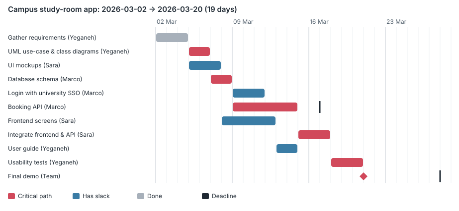
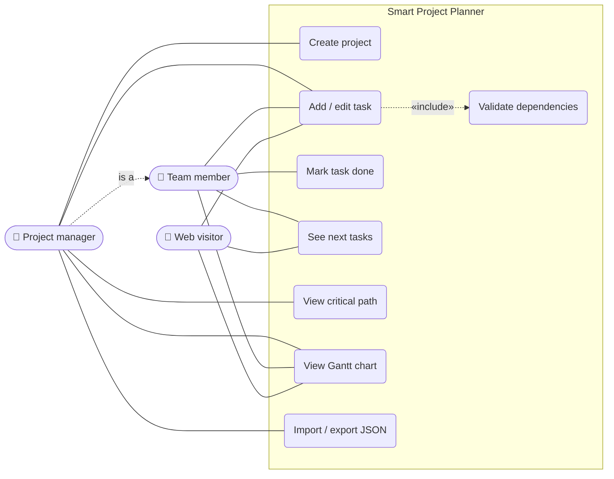
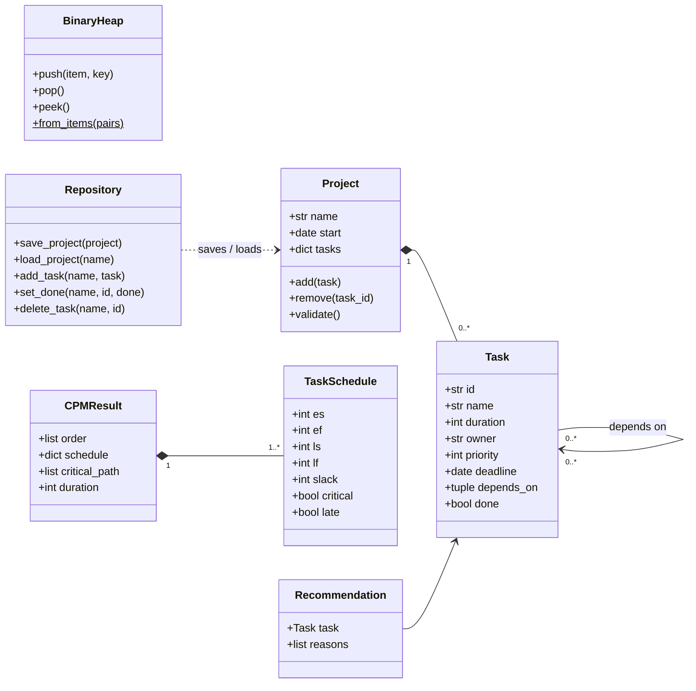
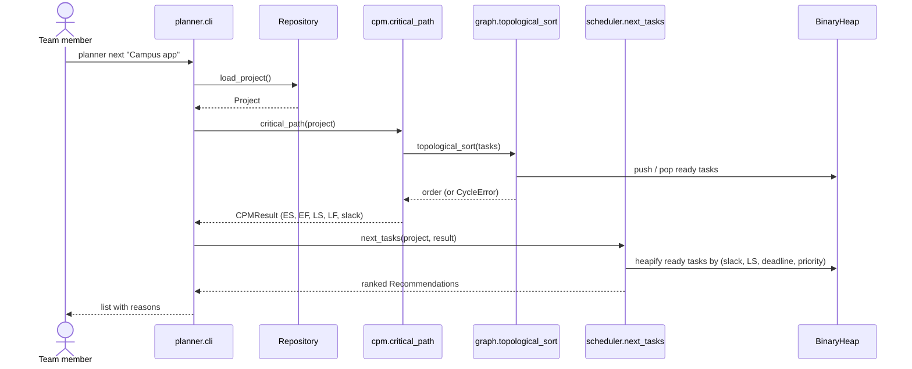

# Smart Project Planner

[](https://github.com/YeganehNourii/2017-smart-project-planner/actions/workflows/tests.yml)
[](https://github.com/YeganehNourii/2017-smart-project-planner/actions/workflows/pages.yml)
[](LICENSE)

A to-do app for a team project that works out **which task to do next** and
draws the **project timeline**. You give it tasks with durations, deadlines,
owners, priorities and "depends on" links. It orders them, finds the critical
path, warns about deadlines it will miss, and draws a Gantt chart.

**Live demo:** https://yeganehnourii.github.io/2017-smart-project-planner/ <!-- DEMO_LINK: live once GitHub Pages is enabled -->
The demo runs the real Python core in your browser with Pyodide.

Origin: BSc courses Data Structures, Systems Analysis & Design and IT Project Management (2017-18), rebuilt in 2026



<!-- Demo GIF: record the live demo (load sample → tick a task → add a task) and save it as docs/demo.gif, then uncomment:

-->

## What it does

- **Next task** — a hand-written **binary heap** ranks the tasks you can start now (all dependencies done). It uses the key *(slack, latest start, deadline, priority)* and explains each pick, for example "on the critical path" or "2 days of slack".
- **Dependency order** — a **topological sort** (Kahn's algorithm). When there is a **cycle**, it reports the cycle itself, for example `dependency cycle: a → c → b → a`.
- **Critical path method** — earliest and latest start and finish and **slack** for every task, the project duration, and the chain of tasks that cannot slip.
- **Smart deadlines** — warns when a task's planned finish is after its deadline.
- **SQLite storage** behind a small data-access layer (Repository), plus JSON import and export.
- **Gantt chart** — Plotly in the browser and as HTML export, or a static SVG (the image above).
- **CLI** and a **static web demo**. Both use the same core.

The scheduling core uses only the Python standard library (3.10+). The heap,
topological sort and CPM are implemented in [`planner/`](planner), not
imported from a library.

## How the scheduling works

| Step | Algorithm | Cost |
|---|---|---|
| Validate & order | Kahn's topological sort. Ready tasks wait in the binary heap, keyed by input position, so the order is deterministic. Leftover tasks mean a cycle. An iterative DFS with white/grey/black colouring then extracts it | O((V+E) log V) |
| Forward pass | `ES = max(EF of dependencies)`, `EF = ES + duration` | O(V+E) |
| Backward pass | `LF = min(LS of dependents)` (or project end), `LS = LF − duration` | O(V+E) |
| Slack | `slack = LS − ES`; 0 ⇒ critical | O(V) |
| Next tasks | Heapify the ready tasks (O(n)), pop the `limit` most urgent | O(n + k log n) |

Example from [`samples/campus-app.json`](samples/campus-app.json):

```text
$ planner import samples/campus-app.json
$ planner show "Campus study-room app"
Campus study-room app: 2026-03-02 → 2026-03-20 (19 days)
  ID         TASK                           OWNER      DAYS      START     FINISH SLACK  DEADLINE
✓ req        Gather requirements            Yeganeh       3 2026-03-02 2026-03-04     0
* uml        UML use-case & class diagrams  Yeganeh       2 2026-03-05 2026-03-06     0
  mock       UI mockups                     Sara          3 2026-03-05 2026-03-07     2
* db         Database schema                Marco         2 2026-03-07 2026-03-08     0
  ...
Critical path: req → uml → db → api → integ → test → demo

$ planner next "Campus study-room app"
1. uml: UML use-case & class diagrams [Yeganeh]
   on the critical path: any delay moves the project end; priority 2
2. mock: UI mockups [Sara]
   2 days of slack
```

## Install and run

```bash
git clone https://github.com/YeganehNourii/2017-smart-project-planner.git
cd 2017-smart-project-planner
python3 -m venv .venv && source .venv/bin/activate
pip install -e ".[dev]"
pytest                      # run the tests
```

Command line (data goes to `planner.db`, or pass `--db FILE`):

```bash
planner import samples/campus-app.json
planner show "Campus study-room app"
planner next "Campus study-room app"
planner add  "Campus study-room app" slides "Demo slides" --duration 2 --owner Sara --after front --deadline 2026-03-18
planner done "Campus study-room app" uml
planner gantt "Campus study-room app" --out gantt.html   # or --out gantt.svg
planner export "Campus study-room app" > project.json
```

Without installing, `python -m planner ...` works too.

### Web demo locally

```bash
python scripts/build_site.py          # copies planner/*.py into site/py/
python -m http.server -d site 8000    # open http://localhost:8000
```

The page loads [Pyodide](https://pyodide.org) and Plotly from a CDN, writes the
`planner` package into Pyodide's virtual file system, and calls
`planner.web.analyse(project_json)` after every change. If Python rejects a
change, for example a task that creates a cycle, the change is undone and the
error is shown. Your project is saved in the browser's `localStorage`.

## UML

Full versions are in [`docs/`](docs): [requirements](docs/requirements.md),
[use cases](docs/use-case-diagram.md), [classes](docs/class-diagram.md) and
[sequences](docs/sequence-diagram.md).

### Use cases



### Classes



### Sequence: "what should I do next?"



## Tests

`pytest` runs 88 tests in [`tests/`](tests). They cover:

- **Heap:** ordering, stability with equal keys, items that cannot be compared, randomised checks of the heap invariant, and O(n) heapify.
- **Topological sort:** empty input, chains, diamonds, independent tasks, missing dependencies, duplicate ids, self-loops, 2- and 3-node cycles (checking the reported cycle is real), and a 5,000-task chain (no recursion-limit problems).
- **CPM:** a worked textbook example with every ES/EF/LS/LF value, milestones, parallel critical branches, an empty project, and deadline lateness.
- **Scheduler:** readiness, ranking and tie-breaks, reasons, and limits.
- **SQLite:** round trips, replacing a project, transactions rolling back on invalid changes, schema constraints (foreign keys, `CHECK`s), and reopening the file.
- **Web bridge and CLI:** end to end.

GitHub Actions runs them on Python 3.10–3.13 on every push
([`tests.yml`](.github/workflows/tests.yml)). [`pages.yml`](.github/workflows/pages.yml)
tests again, then deploys `site/` to GitHub Pages.

## Project layout

```
planner/
  models.py        Task, Project, ValidationError
  heap.py          BinaryHeap (hand-written min-heap)
  graph.py         topological_sort, find_cycle, CycleError
  cpm.py           critical_path → CPMResult / TaskSchedule
  scheduler.py     next_tasks → Recommendation
  storage.py       Repository (SQLite data-access layer)
  serialization.py JSON ⇄ Project
  gantt.py         Plotly figure dict, HTML and SVG output
  web.py           analyse(): JSON in, JSON out (for Pyodide)
  cli.py           command-line interface
site/              static demo (index.html, app.js, style.css)
docs/              requirements + UML (Mermaid), gantt.svg
samples/           campus-app.json
scripts/           build_site.py
tests/             pytest suite
```

## Simplifications

Durations are calendar days (no weekends or holidays), and the plan does not
level resources (one person can have parallel tasks). See
[docs/requirements.md](docs/requirements.md#5-simplifications-out-of-scope).

## License

[MIT](LICENSE) © 2026 Yeganeh Nouri
