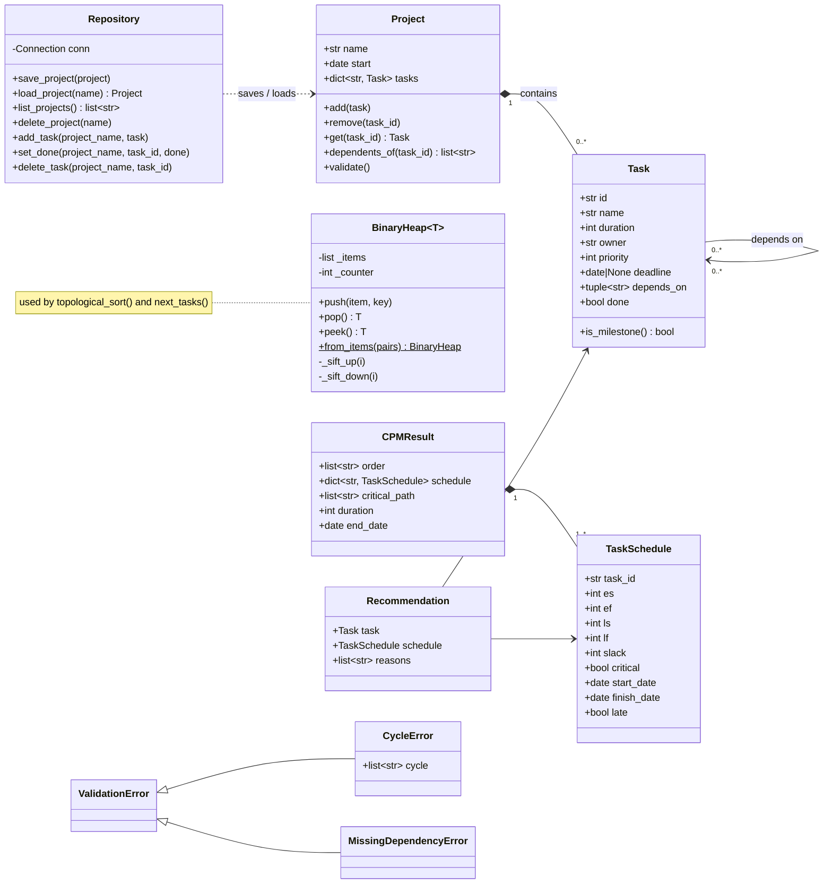

# Class diagram

Module functions (not classes) that tie these together:

| Function | Module | Returns |
|---|---|---|
| `topological_sort(tasks)` | `planner.graph` | `list[str]`, or raises `CycleError` / `MissingDependencyError` |
| `critical_path(project)` | `planner.cpm` | `CPMResult` |
| `next_tasks(project, result, limit)` | `planner.scheduler` | `list[Recommendation]` |
| `gantt_figure(project, result)` | `planner.gantt` | Plotly figure as a plain `dict` |
| `analyse(project_json)` | `planner.web` | JSON string for the web demo |
